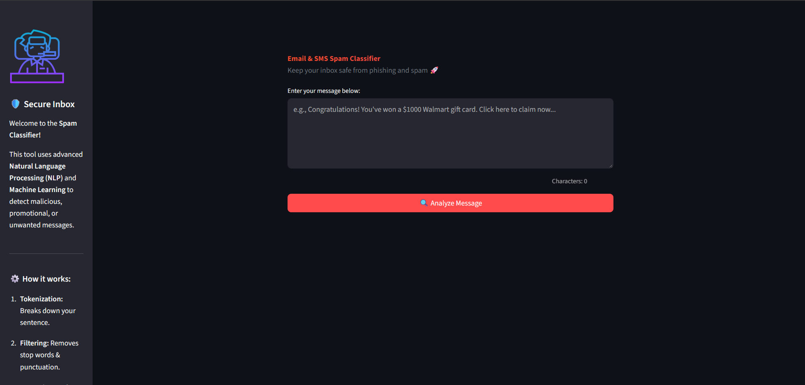
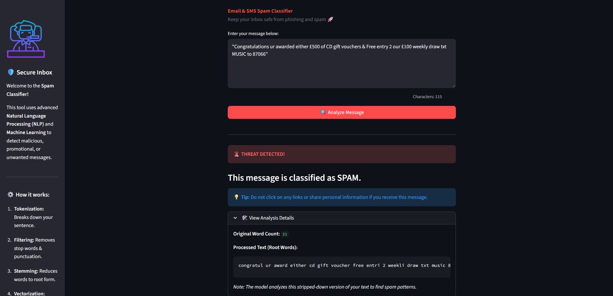

📩 SMS Spam Classifier

A machine learning project to analyze SMS messages and explore the differences between Spam and Ham (Not Spam) messages using Python and data analysis techniques.

🎯 Project Objective

The objective of this project is to explore an SMS dataset, understand its structure, and identify patterns that may help distinguish spam messages from legitimate messages.

🛠️ Technologies & Tools Used

Core Stack:

🐍 Python

🐼 Pandas

🔢 NumPy

📓 Jupyter Notebook

Visualization:

📊 Matplotlib

📈 Seaborn

☁️ WordCloud

Natural Language Processing (NLP):

🗣️ NLTK (Natural Language Toolkit)

🔡 Python string module

🚀 Project Pipeline

1️⃣ Data Loading and Cleaning

Loaded the SMS dataset using Pandas.

Removed unnecessary columns to streamline the data.

Renamed important columns for better readability.

Encoded the target labels (Spam/Ham) into numerical formats.

Removed duplicate messages to ensure model accuracy.

2️⃣ Exploratory Data Analysis (EDA)

Analyzed the distribution of spam and ham messages.

Visualized the dataset balance by creating a pie chart to show the exact percentage of spam vs. ham messages.

3️⃣ Text Preprocessing Pipeline

This phase is crucial for cleaning the raw SMS text data and converting it into a standardized format suitable for machine learning models.

Every message in the dataset passes through a custom preprocessing function (transform_text) that performs the following sequence of operations:

🔤 Lowercase Conversion:
Converts all characters in the text to lowercase to ensure consistency (e.g., "Hello" and "hello" are treated as the exact same word).

✂️ Tokenization:
Splits the sentences into individual words or tokens using NLTK's word_tokenize.

🚫 Removing Special Characters:
Iterates through the tokens and keeps only alphanumeric characters, cleanly filtering out special symbols and emojis.

🛑 Removing Stop Words and Punctuation:
Removes common English stop words (like "is", "the", "and") and standard punctuation marks. These generally do not contribute predictive value for spam classification and only add noise.

🌱 Stemming:
Applies the NLTK PorterStemmer to reduce words to their root or base form (e.g., "dancing", "dances", and "danced" all become "danc"). This dramatically reduces the overall vocabulary size.

Built with Python as part of my Machine Learning learning journey.

## 4. Model Building

In this step, different machine learning algorithms were trained and evaluated to find the best model for SMS spam classification.

### 4.1 Feature Extraction

Text data was converted into numerical features using `CountVectorizer` and `TfidfVectorizer`.

- **Bag of Words (BoW):** Converts text into a numerical representation based on word frequencies.
- **TF-IDF:** Assigns importance to words based on their frequency in a message and across the dataset.

### 4.2 Naive Bayes Classifiers

Three variants of the Naive Bayes algorithm were implemented and evaluated:

- **Gaussian Naive Bayes:** Assumes that features follow a Gaussian distribution.
- **Multinomial Naive Bayes:** Suitable for discrete features such as word counts and TF-IDF values.
- **Bernoulli Naive Bayes:** Works with binary features representing the presence or absence of words.

The models were evaluated using accuracy, confusion matrix, and precision score.

### 4.3 Training Multiple Classification Models

Several machine learning algorithms were trained and compared:

- Support Vector Classifier (SVC)
- K-Nearest Neighbors (KNN)
- Multinomial Naive Bayes
- Decision Tree Classifier
- Logistic Regression
- Random Forest Classifier
- AdaBoost Classifier
- Bagging Classifier
- Extra Trees Classifier
- Gradient Boosting Classifier
- XGBoost Classifier

### 4.4 Model Evaluation

A reusable function was created to train each classifier and evaluate its predictions on the test dataset.

The following evaluation metrics were used:

- **Accuracy:** Measures the overall proportion of correctly classified messages.
- **Precision:** Measures how many messages predicted as spam were actually spam.

The accuracy and precision scores of all classifiers were stored for comparison to identify a suitable model for the spam classification task.

## 🌐 5. Web Application Development

After training and evaluating multiple machine learning models, a web application was developed using **Streamlit** to make the SMS Spam Classifier interactive and easy to use.

The application allows users to enter or paste an SMS or email message and analyze it to determine whether it is **Spam** or **Ham (Not Spam)**.

### 5.1 Technologies Used

- **Streamlit:** Used to build the interactive web interface using Python.
- **NLTK:** Used for text preprocessing, tokenization, stop-word removal, and stemming.
- **TF-IDF Vectorizer:** Converts the preprocessed message into numerical features.
- **Multinomial Naive Bayes:** The trained machine learning model used to classify messages.
- **Pickle:** Used to save and load the trained model and TF-IDF vectorizer.

### 5.2 Loading the Trained Model

The trained Multinomial Naive Bayes model and TF-IDF vectorizer are saved as pickle files and loaded into the application.

- `Models/vectorizer.pkl` — Stores the fitted TF-IDF vectorizer.
- `Models/model.pkl` — Stores the trained Multinomial Naive Bayes classifier.

The Streamlit `@st.cache_resource` decorator is used to cache these objects, avoiding repeated model loading during application interactions.

### 5.3 Message Preprocessing

When a user enters a message, the application applies the same `transform_text()` preprocessing function used during model development.

The preprocessing steps include:

1. Converting the message to lowercase.
2. Tokenizing the text using NLTK.
3. Removing special characters and non-alphanumeric tokens.
4. Removing English stop words and punctuation.
5. Applying Porter stemming to reduce words to their root forms.

This ensures that the input message is processed consistently with the text used to train the model.

### 5.4 Converting Text into Numerical Features

Machine learning models cannot directly understand raw text. Therefore, the preprocessed message is transformed into numerical features using the previously fitted TF-IDF vectorizer.

The vectorizer converts the message into a numerical representation based on the vocabulary and word importance learned from the training data.

### 5.5 Spam Prediction

The numerical features are passed to the trained Multinomial Naive Bayes classifier to generate a prediction.

- **Spam (1):** The message is classified as spam.
- **Ham (0):** The message is classified as not spam.

The predicted class is then displayed to the user through the Streamlit interface.

### 5.6 User Interface and Result Display

The application includes the following interface components:

- A sidebar containing basic application information.
- A text area where users can enter or paste a message.
- An **Analyze Message** button to initiate classification.
- Input validation to prevent analysis of empty messages.
- A loading indicator while the message is being processed.
- A result notification displaying whether the message is spam or not spam.

The interface uses a warning-style alert for spam predictions and a success-style message for non-spam predictions.

## 🔄 6. End-to-End Application Workflow

The complete workflow of the SMS Spam Classifier is:

1. The user enters an SMS or email message.
2. The application validates the input.
3. The text preprocessing function cleans and stems the message.
4. The TF-IDF vectorizer converts the processed text into numerical features.
5. The trained Multinomial Naive Bayes model predicts the message category.
6. Streamlit displays the classification result to the user.

**Workflow:** User Input → Text Preprocessing → TF-IDF Vectorization → Multinomial Naive Bayes Prediction → Result Display

## 🎯 7. Final Outcome

The project combines data analysis, natural language processing, feature extraction, machine learning, and web application development into a single workflow.

The final application allows users to interact with a trained machine learning model through a simple web interface without needing to run the training notebook or write Python code.

### Key Learning Outcomes

- Performed data cleaning and exploratory data analysis on an SMS dataset.
- Implemented text preprocessing using NLTK.
- Explored Bag of Words and TF-IDF feature extraction.
- Trained and compared multiple machine learning classification algorithms.
- Evaluated models using accuracy, precision, and confusion matrices.
- Saved and reused trained machine learning objects with Pickle.
- Built an interactive web application using Streamlit.
- Integrated text preprocessing, vectorization, and prediction into an end-to-end application.

## ⚠️ 8. Limitations

- The prediction depends on the quality and coverage of the training dataset.
- Legitimate messages may occasionally be classified as spam, and spam messages may be classified as legitimate.
- The application displays a predicted category and should not be treated as a guarantee that a message is safe.
- The current implementation uses a traditional machine learning model rather than a deep learning or large language model.

## 🔮 9. Future Improvements

- Deploy the application so users can access it online.
- Add a confidence or probability score to the prediction interface.
- Improve the user interface and add example messages for testing.
- Expand the dataset with more diverse spam and legitimate messages.
- Add automated tests for text preprocessing and model predictions.
- Track model performance and retrain the model when necessary.

---

## 🖥️ Application Screenshots

### 🏠 Home Page

### ✅ Not Spam Prediction

### 🚨 Spam Prediction

**Built with Python, NLTK, Scikit-learn, and Streamlit as part of my Machine Learning learning journey.**

